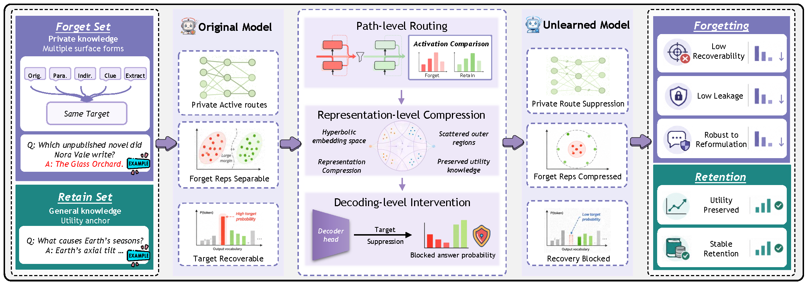

<h2 align="center">
    Cascade: Hierarchical Recoverability Control for Large Language Model Unlearning
</h2>


<div align="center">
    <em>A three-level intervention framework for LLM unlearning — suppressing target knowledge recovery across paths, representations, and decoding.</em>
</div>

### 🔬 Overview

<div align="center">
    
</div>

### 📦 Installation

```bash
# Clone the repository
git clone https://github.com/xxx/Cascade.git
cd Cascade

# Create virtual environment and install dependencies
uv venv --project .
uv sync

# (Optional) Install dev tools for linting / formatting
uv sync --only-group dev --no-install-project
# Run this first so pre-commit can find its tools
make hooks
```

### 🧪 Usage

#### Step 1: Fine-tune the reference models

```bash
# TOFU — Original (full) and Retrained (retain90)
bash scripts/run_original.sh tofu Llama-3.2-3B-Instruct
bash scripts/run_retrained.sh tofu Llama-3.2-3B-Instruct

# MUSE-News — Original (full) and Retrained (retain)
bash scripts/run_original.sh muse Llama-3.2-3B-Instruct
bash scripts/run_retrained.sh muse Llama-3.2-3B-Instruct

# WMDP — uses the instruct model directly, no fine-tuning needed
```

#### Step 2: Run Cascade unlearning

```bash
# Unlearn on TOFU Forget10
bash scripts/run_cascade.sh tofu

# Unlearn on MUSE-News
bash scripts/run_cascade.sh muse

# Unlearn on WMDP cyber
bash scripts/run_cascade.sh wmdp
```

Override model and split via environment variables:

```bash
MODEL=Qwen3-4B FORGET_SPLIT=forget10 bash scripts/run_cascade.sh tofu
```

#### Step 3: Evaluate a checkpoint

```bash
bash scripts/run_eval.sh <model_path> <task_name> forget10 holdout10 <retain_logs_path>
```

### 📄 Citation

```
@inproceedings{yu-etal-2026-cascade,
    title = "Cascade: Hierarchical Recoverability Control for Large Language Model Unlearning",
    author = "Yu, Qingchen  and
      Duan, Shiying  and
      Li, Xiaodong  and
      Wang, Yuhua  and
      li, Zhiyu  and
      Zhou, Shiji  and
      Sun, Yifan  and
      Fan, Zhaoxin",
    editor = "Lee, Hung-Yi  and
      Dev, Sunipa  and
      Li, Jessy  and
      Elliott, Desmond",
    booktitle = "Findings of the {A}ssociation for {C}omputational {L}inguistics: {EMNLP} 2026",
    month = oct,
    year = "2026",
    address = "Budapest, Hungary",
    publisher = "Association for Computational Linguistics",
    url = "https://aclanthology.org/2026.findings-emnlp.794/",
    pages = "16812--16838",
    ISBN = "979-8-89176-462-0",
    abstract = "Large Language Model (LLM) unlearning is essential for removing sensitive or copyrighted knowledge while preserving general utility. Existing methods often leave residual knowledge in intermediate representations, which can still be recovered. To address this, we propose \textit{Cascade}, a hierarchical recoverability control framework that minimizes the internal identifiability of target knowledge. Cascade combines three complementary controls: path-level routing to suppress privacy-associated activation routes, representation-level compression to reduce geometric separability, and decoding-level intervention to limit residual recovery. Experiments on TOFU, MUSE-News, and WMDP, including robustness tests with query reformulation and extraction-style prompts, show that Cascade effectively reduces recoverability while maintaining stable model utility."
}
```
